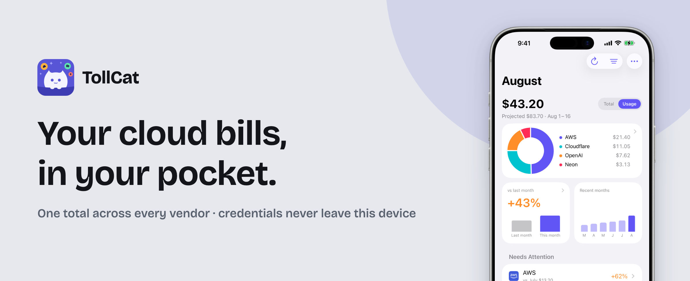
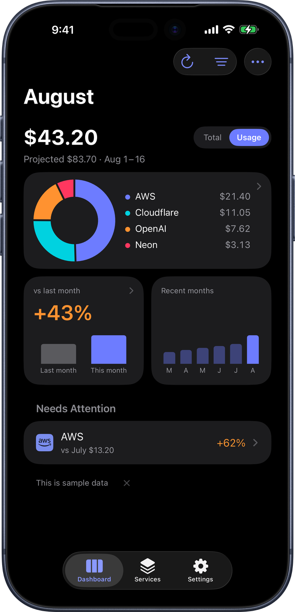
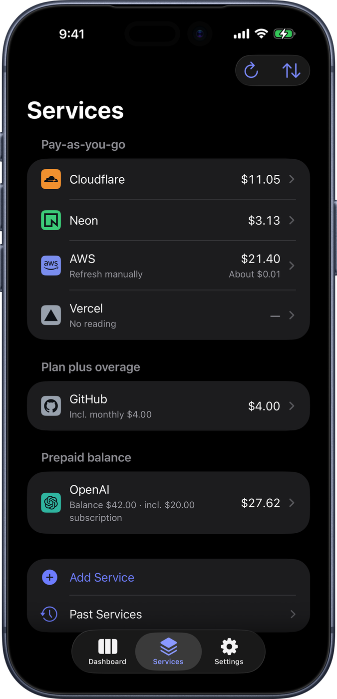
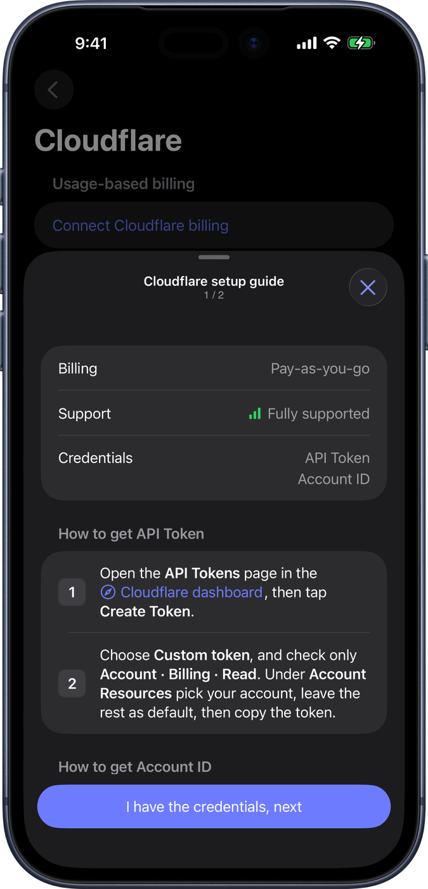
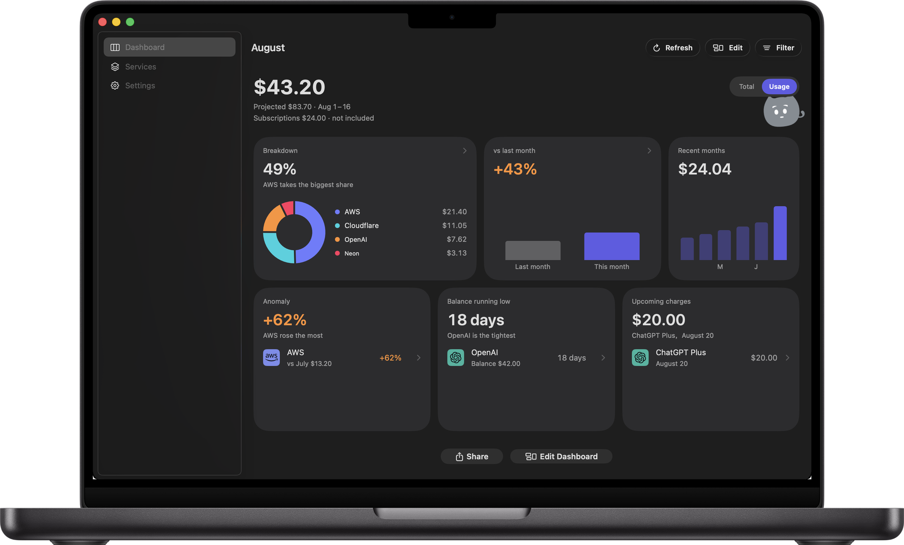
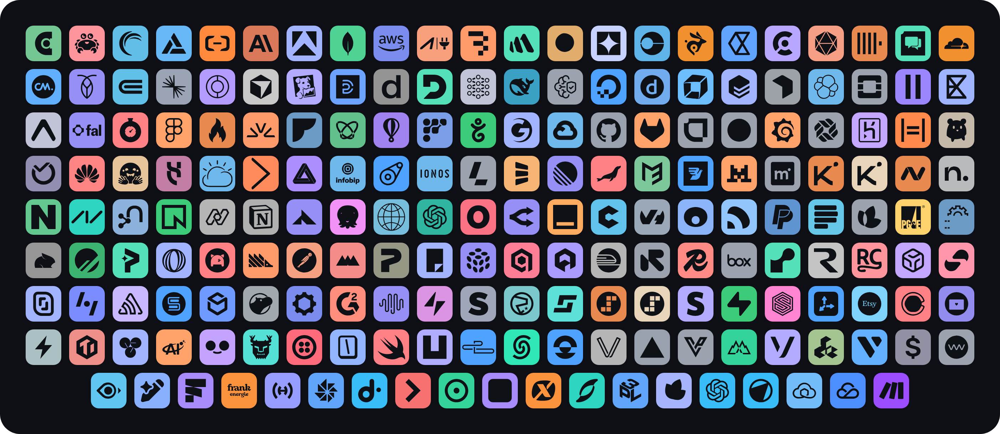

  

# TollCat

English · [中文](README.zh.md) · [日本語](README.ja.md)

TollCat is a billing app for the cloud and AI services you pay for. It adds up what you've spent this month across all of them and gives you one total, with the per-vendor breakdown underneath. Credentials stay in the on-device Keychain — never iCloud, never a backup — and the device talks directly to each vendor's official API, with no server in between. The total also goes wherever you'd glance at it: iPhone widgets, the Mac menu bar.

SwiftUI, iOS 26+ and macOS 26+, iPhone, iPad, and Mac. Free, with optional tips. MIT licensed.

<table>
  <tr>
    <td width="33%"></td>
    <td width="33%"></td>
    <td width="33%"></td>
  </tr>
  <tr>
    <td align="center">One total, with the breakdown underneath</td>
    <td align="center">Every service, grouped by how it bills</td>
    <td align="center">A setup guide per service: read-only, step by step</td>
  </tr>
</table>

  
   The same app on Mac. iPad too.

**Want to see the rest?** iPad, the widgets, the menu bar — every screen is on the landing page, and that's the fastest way to judge whether this is for you: **[tollcat.app](https://tollcat.app)**. Everything it can read a bill from is listed at **[Supported services](https://tollcat.app/providers/)**.

## What it can read

  

220+ services have their bill read straight from the vendor's API. 14 of those are verified against a real account; the rest have a documented billing API and should work, and the app says which is which for every entry. 12 more have no billing API at all, so you post a reading from your own machine instead. The full list, with what each one needs: **[Supported services](https://tollcat.app/providers/)**.

## Where your keys go

- A credential is written to this device's Keychain, and nowhere else. Not iCloud, not a backup, not any TollCat server.
- Every refresh goes from the device straight to the vendor's official API. Nothing sits in between.
- The widget can't make a request at all: its target doesn't link the Providers module.
- The one server this project runs (tips, feedback, the setup catalog) never sees a credential. Providers and Tips can't link each other.
- Want to check that the App Store build is this source? Apple re-signs and encrypts it, so it can't be reproduced byte-for-byte. What can be checked: public CI builds the IPA from a tag with signed provenance, and the Mach-O `LC_UUID` ties that build to the app on your phone. Steps, commands, and the honest limits are in [VERIFY.md](VERIFY.md).

## What's in this repo

- `App/` + `Widget/` + `Mac/` — thin Xcode shells. Two XcodeGen specs generate them: `project.yml` (iOS) and `project-mac.yml` (Mac); don't edit `.pbxproj` by hand.
- `Packages/MeterKit/` — all the Swift code, split into modules. The dependency contract lives in [ARCHITECTURE.md](ARCHITECTURE.md). Two hard lines: the widget doesn't link Providers, so it can't make requests of its own; Providers and Tips never link each other, so billing credentials can't reach the tip worker.
- `Android/` — an Android version in development. Credentials live in the on-device Keystore the same way. Not done yet — stay tuned, or come lend a paw.
- `Windows/` — a WinUI 3 shell over the same Swift core, cross-compiled to a DLL. Written, never yet run on Windows 11.
- `CLI/` — `tollcat`, a terminal command over the same Swift core. This is the Linux version. See [CLI/README.md](CLI/README.md).
- `shared/` — cross-platform sources of truth (JSON + generators). Edit here and regenerate; files with a `GENERATED` header are outputs.
- `site/` — the [tollcat.app](https://tollcat.app) landing page, a static site.
- `worker/` — the project's only server, see below.
- `ops/` — a local TUI (Ink + bun). Uses your wrangler login to inspect feedback, tips, the inbox, usage, and unapplied migrations. `bash scripts/ops`

## The server

`worker/` runs at api.tollcat.app and handles five things: tip notes, in-app feedback, the public setup catalog, the reading inbox for services without a billing API, and anonymous page counts. None of these paths ever touch a provider credential.

To run your own: steps are in [worker/README.md](worker/README.md). Check the routes in `wrangler.toml` before deploying, then point `origin` in `Packages/MeterKit/Sources/MeterTips/TipWorkerEndpoint.swift` at your worker and add the host to `OutboundHosts.swift`.

## Roadmap

Rough order, no dates:

1. **More services, more of them verified** — this one never closes: grow the supported list and move entries from "should work" to "tested against a real account", driven by feedback and by trying things ourselves.
2. **Android (phones)** — bring the in-repo Android version up to shipping quality. Tablets are out of scope.
3. **Windows** — the source is in the repo (WinUI 3 shell over the same Swift core), but it has never been run on Windows 11. Getting one real bill on screen there is the next step.

## Commitment

This project is under active maintenance: we read and fix issues, and the roadmap above keeps moving. As long as this paragraph is here, you can count on that — we check our own bills with it every day.

PRs are welcome too. A clearly written fix that maps to a concrete bug earns our genuine gratitude. Feature changes we weigh more carefully — if in doubt, open an issue first — but they're just as welcome. Merged or not, thank you for spending the time.

## Support TollCat

If you'd like to support TollCat, there are two ways:

- [GitHub Sponsors](https://github.com/sponsors/KUD-00)
- A tip inside the app (Settings → Tip) — it treats the kitty

## Sponsorship

Tips alone probably won't pay for this. If enough people end up using TollCat for it to be worth keeping alive, we may take a sponsor, one at a time. That sponsor would show up in three places:

- First place in the store screenshots and the landing page examples
- A credit under Settings → About, labelled as a sponsor
- Now and then, a note on its own detail page — a new feature, a plan that's cheaper now

None of it is in the app today. If it happens, these don't change:

- **No ad network, no third-party SDK.** Anything you see came from us.
- **What we say about a service isn't for sale.** That description is our own read, and sponsorship doesn't rewrite it.
- **What you connect and spend stays on your device.** Sponsor notes come with the public catalog, and your phone picks the relevant one locally.
- **Nothing interrupts you.** No popups, no notifications, and nothing beside the total on your dashboard.

The source is MIT and right here, so a build that crosses one of these lines shows up in the diff.

## License

The code is MIT — see [LICENSE](LICENSE). Use it, change it, ship it, sell it.

The brand isn't part of that grant: the TollCat name, the app icon, and the cat artwork stay ours. If you distribute a modified build, give it its own name and icon, so nobody mistakes it for the app we sign and publish — and make it actually your own app. If this one turns up on the App Store or Google Play under a different name with little else changed, we’ll report it. Both stores have rules against duplicate listings, and a new name doesn’t clear them.

Vendor logos in the app aren't ours either, and they aren't MIT. Marks from [Simple Icons](https://simpleicons.org) are CC0; the rest are official SVGs we only scaled to fit a 24×24 tile. The names and marks belong to their owners — we use them to say which bills we can read, not as an endorsement. Sources are in [THIRD-PARTY-NOTICES.md](THIRD-PARTY-NOTICES.md); if that use looks wrong, open an issue.
